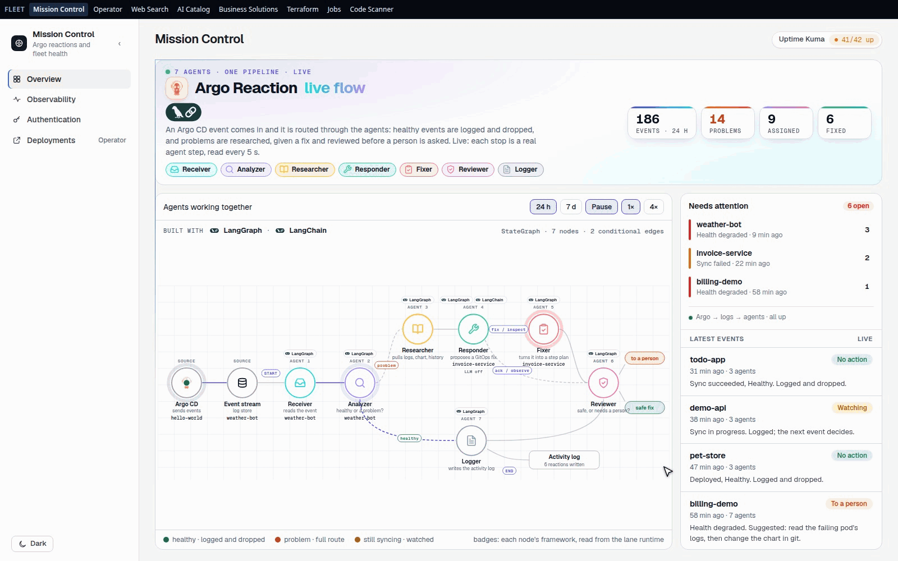

# Warden AI

## Executive summary

Warden AI watches every  [Argo CD](https://argo-cd.readthedocs.io) deployment event on a self-hosted Kubernetes cluster and keeps problems from sitting unseen: each event is sent to the  [VictoriaLogs](https://victoriametrics.com/products/victorialogs/) log store with every hop on the way checked, so a broken one is named, and a  [LangGraph](https://langchain-ai.github.io/langgraph/) team of seven agent roles (receive, analyze, research, respond, fix, review, log), with  [LangChain](https://python.langchain.com) tool calls into  [Model Context Protocol](https://modelcontextprotocol.io) tools, reads it. Healthy events are logged and dropped, and problems are researched, given a proposed fix and reviewed before a person is asked to act; nothing risky happens on its own.

- **Mission Control** lists the open problems worst first, shows each event moving through the seven agent roles, and stores every step in  [OpenSearch](https://opensearch.org) so any decision can be traced afterward.

## In action

**Watch deployment events move through the agents.** Each event passes the seven  [LangGraph](https://langchain-ai.github.io/langgraph/) agent roles on Mission Control.

The clip is recorded on demo data.

## Architecture

Warden AI is one web page on a self-hosted Kubernetes cluster, kept in step with git by  [Argo CD](https://argo-cd.readthedocs.io), which also deploys the  [LangGraph](https://langchain-ai.github.io/langgraph/) and  [LangChain](https://python.langchain.com) agents and the  [Model Context Protocol](https://modelcontextprotocol.io) tools they call through the  [ToolHive](https://github.com/stacklok/toolhive) gateway:

- **Web UI.** The  [React](https://vite.dev) page and its  [FastAPI](https://fastapi.tiangolo.com) backend ship together to Kubernetes through  [Argo CD](https://argo-cd.readthedocs.io).
- **Data pipeline.**  [Argo CD](https://argo-cd.readthedocs.io) sends each deployment event to  [VictoriaLogs](https://victoriametrics.com/products/victorialogs/), which holds the event logs, and  [OpenSearch](https://opensearch.org) stores every agent step.
- **AI.**  [LangGraph](https://langchain-ai.github.io/langgraph/) and  [LangChain](https://python.langchain.com) run the seven agent roles, and the  [ToolHive](https://github.com/stacklok/toolhive) gateway fronts the  [Model Context Protocol](https://modelcontextprotocol.io) tool servers they call.
- **Credentials.** Every key comes from a password manager at run time; none is in the code or the images.

## License

PolyForm Noncommercial 1.0.0 with a required notice from Haya Tech LLC. Noncommercial use is free; any commercial use, including resale, hosting for others, or a paid product, needs a written license from Haya Tech LLC first. See [LICENSE](LICENSE).
